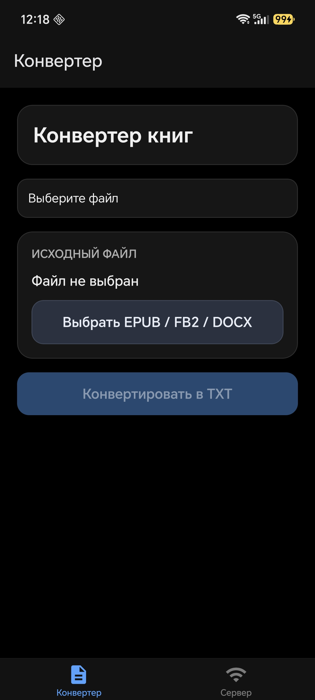
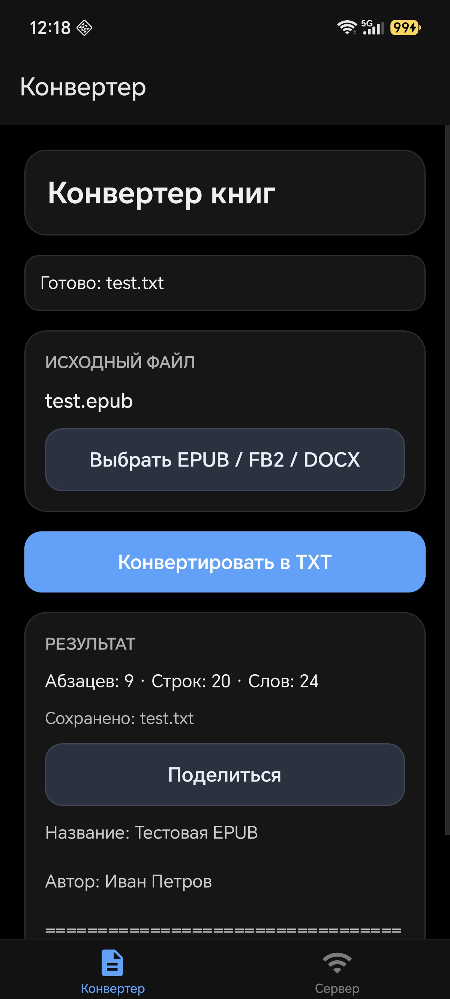
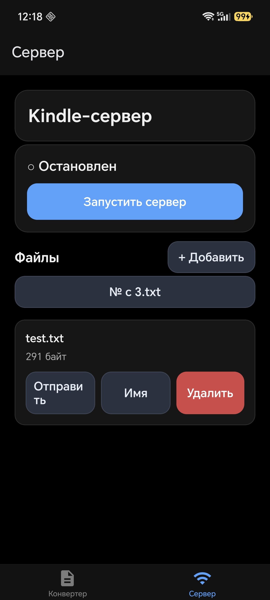
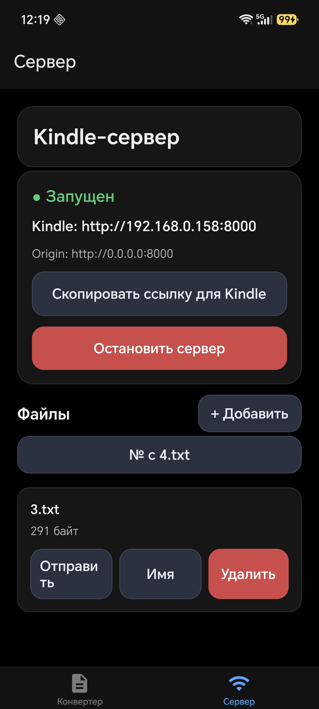
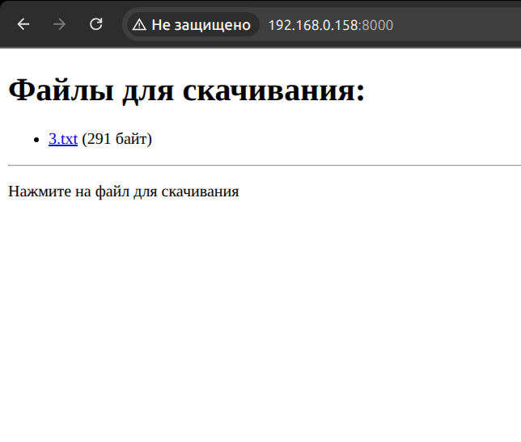

# Kindle Tools

Android-приложение: конвертирует книги в TXT и раздаёт готовые TXT по Wi-Fi, чтобы открыть их в браузере Kindle.

## Скриншоты

<p>
  
  
</p>

<p>
  
  
  
</p>

## Что умеет

- EPUB, FB2, DOCX → TXT. Название и автор берутся из метаданных (OPF у EPUB, `core.xml` у DOCX).
- Абзацы сохраняются, теги, скрипты и навигация вырезаются.
- Результат пишется в `uploads/`, оттуда его можно отправить через системный «Поделиться».
- Локальный HTTP-сервер на порту 8000: список файлов и скачивание. Раздаёт только `.txt`, остальное не показывается и не отдаётся.
- Добавление файлов по одному или пачкой (множественный выбор).
- Переименование, удаление, пакетная нумерация TXT.
- Счётчик нумерации хранится на телефоне. Подхватывает максимальный номер из `uploads/` и запоминает ручное переименование: назвал файл `320.txt` — следующий будет 321.
- `uploads/` очищается при каждом запуске приложения.

## Как устроено

Expo SDK 58, expo-router, TypeScript. Конвертация — JSZip, fast-xml-parser, htmlparser2. Сервер — `react-native-tcp-socket`, поэтому он работает только в нативной сборке, в Expo Go его нет.

```
src/app/(tabs)/index.tsx   конвертер
src/app/(tabs)/server.tsx  сервер и список файлов
src/lib/convert.ts         EPUB/FB2/DOCX → текст
src/lib/server.ts          HTTP на 8000
src/lib/filesystem.ts      uploads, размеры, копирование
src/lib/counter.ts         счётчик номеров
```

## Запуск

```
npm install
npx expo start
```

В Expo Go работает только конвертер. Для сервера нужна нативная сборка:

```
npx expo prebuild -p android
npx expo run:android
```

Release APK:

```
cd android
./gradlew assembleRelease
```

Готовый файл: `android/app/build/outputs/apk/release/app-release.apk`. Подписан debug-ключом из шаблона — для установки руками этого достаточно, для Google Play нужен свой keystore.

## Мелочи

- Телефон и Kindle должны быть в одной Wi-Fi сети. VPN может мешать доступу к локальным адресам.
- Порт по умолчанию 8000, меняется на вкладке «Сервер». Адрес для Kindle показывается там же.
- Пакет: `com.akelc.kindletools`.
